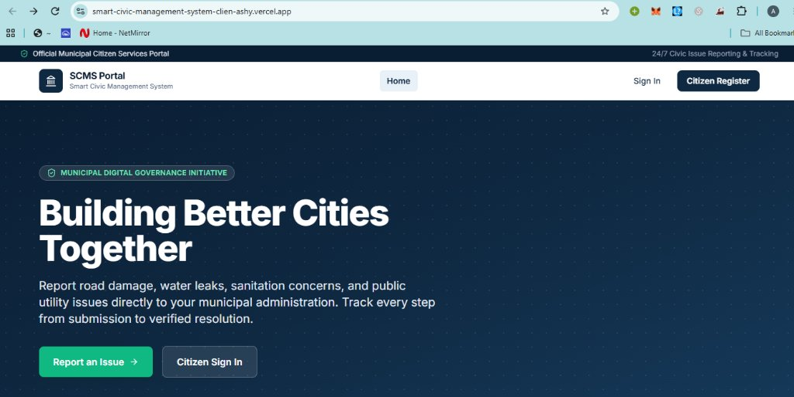
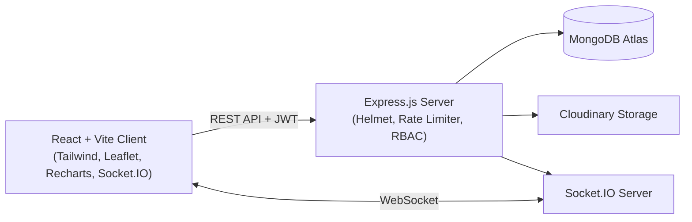

<div align="center">
  
  <h1>Smart Civic Management System (SCMS)</h1>
  <p><strong>Building Better Cities Together</strong></p>
  <p>
    A full-stack MERN civic engagement and municipal operations platform connecting <strong>Citizens</strong>, <strong>Government Officials</strong>, and <strong>Municipal Workers</strong> through geo-tagged issue reporting, smart prioritization, real-time tracking, and geospatial analytics.
  </p>

  <p>
    <a href="https://smart-civic-management-system-clien-ashy.vercel.app/"><strong>Live Website</strong></a>
    &nbsp;&bull;&nbsp;
    <a href="https://scms-backend-zn22.onrender.com/api/health"><strong>Backend API Health</strong></a>
    &nbsp;&bull;&nbsp;
    <a href="./docs/API.md"><strong>API Docs</strong></a>
    &nbsp;&bull;&nbsp;
    <a href="./docs/FINAL_PROJECT_REPORT.md"><strong>Full Project Report</strong></a>
  </p>

  <p>
    
    
    
    
    
  </p>
</div>

---

## Table of Contents

1. [Live Application & Screenshots](#1-live-application--screenshots)
2. [Project Overview & Problem Statement](#2-project-overview--problem-statement)
3. [Objectives](#3-objectives)
4. [User Roles & Functionalities](#4-user-roles--functionalities)
5. [Key Features](#5-key-features)
6. [System Architecture & Workflow](#6-system-architecture--workflow)
7. [Technology Stack](#7-technology-stack)
8. [Project Structure](#8-project-structure)
9. [Local Setup & Installation](#9-local-setup--installation)
10. [Deployment](#10-deployment)
11. [Testing & Verification](#11-testing--verification)
12. [Security Measures](#12-security-measures)
13. [Future Enhancements](#13-future-enhancements)
14. [Project Team](#14-project-team)
15. [Conclusion](#15-conclusion)

---

## 1. Live Application & Screenshots

- **Live Web Portal:** https://smart-civic-management-system-clien-ashy.vercel.app/
- **Backend API:** https://scms-backend-zn22.onrender.com/api/health

### Landing Page


### Platform Capabilities


---

## 2. Project Overview & Problem Statement

Traditional municipal grievance workflows rely on fragmented phone helplines, paper forms, and opaque status updates. Citizens have no reliable way to verify progress, administrators lack geospatial hotspot visibility and SLA tracking, and field crews lack structured before-and-after verification.

**SCMS** solves this by unifying all three stakeholders on a single digital platform:
- **Citizens** report local infrastructure issues (road damage, garbage collection, water leakage, drainage, streetlights, electricity, sanitation) with interactive map coordinates and photographic evidence.
- **Government Officials** verify reports, review rule-based priority and duplicate flags, dispatch department-matched municipal workers with deadlines, audit before-and-after completion photos, and monitor analytics.
- **Municipal Workers** receive real-time task assignments, update field progress, and submit completion photographs for official sign-off.

---

## 3. Objectives

- Deliver an accessible, mobile-responsive portal for citizens to report and track civic issues end-to-end.
- Enforce strict role-based access control (RBAC) across Citizen, Government Official, and Municipal Worker portals.
- Improve municipal response times with rule-based smart priority suggestions, duplicate detection, and SLA deadline monitoring.
- Provide geospatial complaint heatmaps and Recharts analytics for data-driven city governance.
- Ensure transparent resolution accountability using immutable status histories, before-and-after photo verification, and citizen feedback.

---

## 4. User Roles & Functionalities

| Role | Core Capabilities |
|---|---|
| **Citizen** | Secure registration/login, geo-tagged complaint submission with up to 5 photos, pre-submission duplicate warning, live status timeline, real-time notifications, 1–5 star feedback on closed tickets, and complaint reopening. |
| **Government Official (Admin)** | 8-metric control center, complaint verification/rejection, priority override (`Low` / `Medium` / `High` / `Emergency`), municipal worker registration & management, deadline-based worker assignment, before-and-after photo verification, SLA escalation, Leaflet.heat heatmap, and Recharts analytics with CSV export. |
| **Municipal Worker** | Dedicated field dashboard (total, pending, ongoing, completed, overdue), task acceptance, `In Progress` status updates with remarks, and completion photo submission for official verification (cannot close complaints directly). |

---

## 5. Key Features

| Feature | Implementation Highlights |
|---|---|
| **Interactive Geo-Mapping** | Leaflet & OpenStreetMap pin selection, browser GPS detection, and read-only detail maps |
| **Multi-Photo Evidence** | Multer validation (JPEG/PNG/WEBP, max 5 MB) + Cloudinary cloud storage |
| **Smart Priority Engine** | Transparent rule-based scoring (`0–100`) using category, severity, hazard keywords, and nearby reports |
| **Duplicate Detection** | Haversine distance (`<= 300m`) + Jaccard text similarity warning before submission and flagging for officials |
| **SLA & Escalation** | UTC deadline tracking (`On Track`, `Due Soon`, `Overdue`), automated overdue alerts, and Emergency escalation |
| **Before & After Audit** | Side-by-side comparison of citizen issue photos and worker completion photos before ticket closure |
| **Real-Time Notifications** | Socket.IO live events persisted in MongoDB with read/unread tracking |
| **Analytics & Heatmaps** | Recharts time-series, category, priority, department, and worker performance charts + `leaflet.heat` hotspots |

---

## 6. System Architecture & Workflow



### Complaint Lifecycle

```text
Submitted ──► Verified ──► Assigned ──► In Progress ──► Resolved - Pending Verification ──► Closed
                 │                                                      │
                 ▼                                                      ▼
              Rejected                                              Reopened
```

---

## 7. Technology Stack

| Layer | Technologies |
|---|---|
| **Frontend** | React 18, Vite, Tailwind CSS, React Router DOM, Axios, Lucide React, Leaflet, React-Leaflet, Leaflet.heat, Recharts, Socket.IO Client |
| **Backend** | Node.js, Express.js, Mongoose, Socket.IO, JSON Web Tokens (JWT), bcrypt, Multer, Helmet, Express Rate Limit |
| **Database & Storage** | MongoDB Atlas, Cloudinary |
| **Deployment** | Vercel (Frontend), Render (Backend), GitHub (Source Control) |

---

## 8. Project Structure

```text
smart-civic-management-system/
├── client/                     # React + Vite frontend (deployed on Vercel)
│   ├── src/
│   │   ├── api/                # Axios instance with JWT interceptors
│   │   ├── components/         # Reusable UI, map picker, timeline, badges
│   │   ├── constants/          # Roles, categories, statuses, priorities
│   │   ├── context/            # AuthContext & SocketContext
│   │   └── pages/              # Citizen, Admin, and Worker pages
│   ├── vercel.json
│   └── package.json
├── server/                     # Node.js + Express backend (deployed on Render)
│   ├── src/
│   │   ├── config/             # MongoDB, Cloudinary, Socket.IO setup
│   │   ├── constants/          # Role & workflow enums
│   │   ├── controllers/        # Auth, Complaint, Dashboard, Admin, Worker, Analytics
│   │   ├── middleware/         # JWT protect, RBAC authorizeRoles, Multer, Error handler
│   │   ├── models/             # User, Worker, Complaint, Assignment, StatusHistory, Notification, Feedback
│   │   ├── routes/             # Modular REST API routes
│   │   ├── seed/               # Sample database seeder
│   │   ├── tests/              # Automated Phase 2 & Phase 3 test suites
│   │   └── utils/              # Priority engine, duplicate detector, SLA monitor, notify
│   └── package.json
├── docs/                       # Documentation, architecture, UML/ER diagrams & screenshots
│   ├── assets/scms-logo.svg
│   ├── screenshots/
│   ├── API.md
│   ├── ARCHITECTURE.md
│   ├── DEPLOYMENT_GUIDE.md
│   └── FINAL_PROJECT_REPORT.md
├── package.json                # Root workspace scripts for Render
├── render.yaml                 # Render deployment blueprint
└── README.md
```

---

## 9. Local Setup & Installation

### Prerequisites
- Node.js v18+ and npm
- MongoDB Atlas URI (or local MongoDB instance)
- Cloudinary account (optional in development mode; falls back to local `server/uploads/`)

### 1. Clone & Install
```bash
git clone https://github.com/Ashmitha148/smart-civic-management-system.git
cd smart-civic-management-system

cd server && npm install
cd ../client && npm install
```

### 2. Configure Environment Variables

**`server/.env`** (copy from `server/.env.example`):
```env
PORT=5000
NODE_ENV=development
MONGO_URI=your_mongodb_connection_string
JWT_SECRET=your_secure_jwt_secret
CLIENT_URL=http://localhost:5173
CLOUDINARY_CLOUD_NAME=your_cloud_name
CLOUDINARY_API_KEY=your_api_key
CLOUDINARY_API_SECRET=your_api_secret
```

**`client/.env`** (copy from `client/.env.example`):
```env
VITE_API_URL=http://localhost:5000/api
```

### 3. Seed Sample Data & Run
```bash
# Optional: seed sample Citizen, Official, and Worker accounts
cd server
npm run seed

# Start Backend (http://localhost:5000)
npm run dev
```

In a second terminal:
```bash
# Start Frontend (http://localhost:5173)
cd client
npm run dev
```

---

## 10. Deployment

| Component | Platform | Live Endpoint |
|---|---|---|
| **Frontend** | Vercel | https://smart-civic-management-system-clien-ashy.vercel.app/ |
| **Backend & Socket.IO** | Render | https://scms-backend-zn22.onrender.com |
| **Database** | MongoDB Atlas | Cloud Cluster |
| **Media Storage** | Cloudinary | `scms/complaints` |

---

## 11. Testing & Verification

Automated unit, integration, system, security, and performance tests are included under `server/src/tests/`:

```bash
cd server
node src/tests/phase2.test.js
node src/tests/phase3.test.js
```

| Suite | Coverage | Result |
|---|---|---|
| `phase2.test.js` | RBAC enforcement (`403`), verification, worker assignment, worker closure block (`403`), completion approval, notifications | **8 / 8 Passed** |
| `phase3.test.js` | Smart priority scoring, Haversine & Jaccard duplicate detection, SLA overdue calculation, feedback & duplicate-rating guard (`409`), reopen & escalation, 500-record scan (`2.31ms`) | **11 / 11 Passed** |
| `client` build | `npm run build` (Vite production bundle) | **Passed (`2351` modules)** |

---

## 12. Security Measures

- **Password Security:** `bcrypt` hashing (12 salt rounds) with password fields excluded from JSON responses.
- **Authentication & RBAC:** JWT Bearer verification (`protect`) and strict role guards (`authorizeRoles`) on backend routes and React `ProtectedRoute` on frontend.
- **Registration Guard:** Public `/api/auth/register` strictly assigns the `citizen` role and rejects attempts to self-assign `official` or `worker`.
- **API & Upload Hardening:** `helmet` HTTP security headers, `express-rate-limit` on API and auth routes, strict CORS origin checking, and Multer MIME/size validation (`JPEG`/`PNG`/`WEBP`, max 5 MB).

---

## 13. Future Enhancements

- AI-powered image classification for automatic civic issue tagging.
- Multilingual citizen interface (i18n) for regional accessibility.
- Web Push & SMS alerts for field workers in low-connectivity zones.
- Predictive maintenance analytics for recurring seasonal civic hotspots.

---

## 14. Project Team

| Name | Enrollment Number |
|---|---|
| **Ashmitha** | LCS2025060 |
| **Akshara** | LCS2025005 |
| **Amishka** | LCS2025058 |
| **Sapna** | LIT2025051 |

---

## 15. Conclusion

The **Smart Civic Management System (SCMS)** delivers an end-to-end, production-deployed solution for modern municipal governance—combining citizen-friendly geo-tagged reporting, disciplined role-based workflows, before-and-after verification, real-time notifications, and actionable city analytics.

---

<p align="center">
  <strong>Smart Civic Management System (SCMS)</strong> &bull; Building Better Cities Together
</p>
