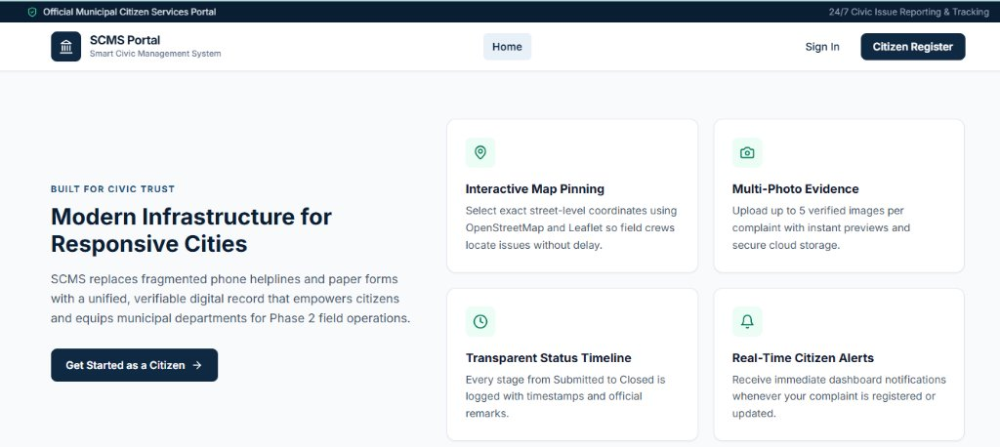

<div align="center">
  
  <h1>Smart Civic Management System (SCMS)</h1>
  <h3>Building Better Cities Together</h3>
  <p>
    A full-stack civic engagement and municipal management platform that connects citizens, government officials, and municipal workers through a centralized complaint management system.
  </p>
  <p>
    <a href="https://smart-civic-management-system-clien-ashy.vercel.app/">
      <strong>Live Website</strong>
    </a>
    &nbsp; | &nbsp;
    <a href="https://scms-backend-zn22.onrender.com/api/health">
      <strong>Backend API Health</strong>
    </a>
    &nbsp; | &nbsp;
    <a href="https://github.com/Ashmitha148/smart-civic-management-system">
      <strong>GitHub Repository</strong>
    </a>
  </p>
</div>

---

## Website Preview

Explore the deployed application:

**[Smart Civic Management System – Live Demo](https://smart-civic-management-system-clien-ashy.vercel.app/)**

## Screenshots

The following screenshots showcase the major interfaces of the application.

### 1. Landing Page


### 2. Platform Features



### 3. Citizen Dashboard


### 4. Complaint Registration


### 5. Government Admin Dashboard


### 6. Municipal Worker Dashboard


---

## 1. Project Overview

The Smart Civic Management System is designed to digitize and streamline the process of reporting, assigning, tracking, and resolving civic issues.

Traditional complaint management systems often involve manual reporting, delayed responses, limited transparency, and inefficient coordination between citizens and municipal authorities.

SCMS addresses these challenges by providing a centralized digital platform where citizens can report civic problems, administrators can manage and assign complaints, and municipal workers can update resolution progress.

## 2. Problem Statement

Citizens frequently encounter civic issues such as:

- Damaged roads and potholes
- Garbage accumulation
- Water supply problems
- Drainage and sewage issues
- Streetlight failures
- Public infrastructure damage

Existing manual complaint processes can make it difficult to track complaints, monitor resolution timelines, and ensure accountability.

SCMS aims to improve civic administration through digital reporting, transparent tracking, automated prioritization, and coordinated workforce management.

## 3. Objectives

- Provide citizens with an accessible platform to report civic issues.
- Enable authorities to efficiently verify and manage complaints.
- Improve coordination between administrators and municipal workers.
- Track complaint progress through transparent status updates.
- Support location-based complaint reporting and visualization.
- Improve accountability through deadlines, escalation, and feedback.
- Provide analytical insights into complaint resolution performance.

## 4. User Roles and Functionalities

### Citizen

- Register and securely log in.
- Submit complaints with descriptions, categories, images, and location details.
- Track complaint status and resolution history.
- Receive real-time notifications.
- Provide feedback after complaint resolution.
- Reopen complaints when necessary.

### Government Official / Administrator

- Access an administrative dashboard.
- Review, verify, or reject submitted complaints.
- Assign complaints to municipal workers.
- Set deadlines and monitor resolution progress.
- Manage workers and complaint priorities.
- Verify completion evidence using before-and-after images.
- Monitor overdue complaints and SLA performance.
- View geographical complaint heatmaps and analytics.

### Municipal Worker

- View assigned complaints.
- Accept assigned tasks.
- Update task progress.
- Upload completion photographs.
- Submit completed work for administrative verification.
- Track pending, ongoing, completed, and overdue tasks.

## 5. Key Features

| Feature | Description |
|---|---|
| Complaint Management | Centralized civic complaint registration and tracking |
| Location Mapping | Interactive maps using Leaflet and OpenStreetMap |
| Image Uploads | Complaint and resolution image uploads using Cloudinary |
| Smart Prioritization | Rule-based complaint priority suggestions |
| Duplicate Detection | Warnings for potentially duplicate complaints |
| Real-Time Notifications | Socket.IO-based notification system |
| SLA Monitoring | Deadline tracking and escalation |
| Worker Management | Assignment and performance monitoring |
| Complaint Heatmaps | Geographical visualization of complaint concentration |
| Analytics Dashboard | Complaint statistics and charts using Recharts |
| Feedback System | Citizen feedback and complaint reopening |

## 6. Technology Stack

### Frontend
- React.js
- Vite
- Tailwind CSS
- JavaScript
- React Router DOM
- Axios
- Leaflet
- React Leaflet
- Leaflet.heat
- Recharts
- Lucide React

### Backend
- Node.js
- Express.js
- REST APIs
- Socket.IO
- JSON Web Tokens (JWT)
- bcrypt
- Multer
- Helmet
- Express Rate Limit

### Database and Cloud Services
- MongoDB Atlas
- Mongoose
- Cloudinary

### Deployment and Development Tools
- Git and GitHub
- Vercel
- Render

## 7. System Architecture

SCMS follows a client-server architecture.

1. The React frontend provides separate interfaces for citizens, administrators, and municipal workers.
2. The Express backend exposes REST APIs for authentication, complaint management, dashboards, and notifications.
3. MongoDB stores user accounts, complaints, assignments, feedback, and notification records.
4. Cloudinary stores uploaded complaint and completion images.
5. Socket.IO supports real-time notifications.
6. Leaflet and OpenStreetMap provide geographical visualization.

## 8. Complaint Resolution Workflow

1. A citizen registers and submits a complaint.
2. The system records the complaint details, category, images, and location.
3. An administrator reviews and verifies the complaint.
4. The administrator assigns the complaint to a municipal worker.
5. The worker accepts the task and updates its progress.
6. The worker uploads completion evidence.
7. The administrator verifies the submitted work.
8. The complaint is marked as resolved.
9. The citizen can provide feedback or reopen the complaint if necessary.

## 9. Project Structure

```text
smart-civic-management-system/
│
├── client/
│   ├── src/
│   │   ├── api/
│   │   ├── components/
│   │   ├── constants/
│   │   ├── context/
│   │   ├── pages/
│   │   │   ├── admin/
│   │   │   └── worker/
│   │   ├── App.jsx
│   │   └── main.jsx
│   ├── vercel.json
│   └── package.json
│
├── server/
│   ├── src/
│   │   ├── config/
│   │   ├── constants/
│   │   ├── controllers/
│   │   ├── middleware/
│   │   ├── models/
│   │   ├── routes/
│   │   ├── seed/
│   │   ├── tests/
│   │   ├── utils/
│   │   ├── app.js
│   │   └── server.js
│   └── package.json
│
├── docs/
│   ├── assets/
│   ├── screenshots/
│   ├── API.md
│   ├── ARCHITECTURE.md
│   ├── DEPLOYMENT_GUIDE.md
│   └── FINAL_PROJECT_REPORT.md
│
├── package.json
├── README.md
└── render.yaml
```

## 10. Installation and Setup

### Prerequisites

- Node.js and npm
- MongoDB Atlas account
- Cloudinary account
- Git

### Step 1: Clone the Repository

```bash
git clone https://github.com/Ashmitha148/smart-civic-management-system.git

cd smart-civic-management-system
```

### Step 2: Install Backend Dependencies

```bash
cd server
npm install
```

### Step 3: Configure Backend Environment Variables

Create a `.env` file inside the `server` directory.

```env
PORT=5000
NODE_ENV=development
MONGO_URI=your_mongodb_connection_string
JWT_SECRET=your_secure_jwt_secret
CLIENT_URL=http://localhost:5173

CLOUDINARY_CLOUD_NAME=your_cloud_name
CLOUDINARY_API_KEY=your_api_key
CLOUDINARY_API_SECRET=your_api_secret
```

### Step 4: Install Frontend Dependencies

```bash
cd ../client
npm install
```

### Step 5: Configure Frontend Environment Variables

Create a `.env` file inside the `client` directory.

```env
VITE_API_URL=http://localhost:5000/api
```

### Step 6: Run the Application

Start the backend:

```bash
cd server
npm run dev
```

Start the frontend in a separate terminal:

```bash
cd client
npm run dev
```

Open the local development URL displayed by Vite, usually:

```text
http://localhost:5173
```

## 11. Deployment

The application is deployed using:

| Component | Platform |
|---|---|
| Frontend | Vercel |
| Backend | Render |
| Database | MongoDB Atlas |
| Image Storage | Cloudinary |

**Live Application:**  
https://smart-civic-management-system-clien-ashy.vercel.app/

**Backend Health Endpoint:**  
https://scms-backend-zn22.onrender.com/api/health

Environment variables and production configuration must be set in the respective deployment platforms. Never commit `.env` files or expose database credentials and secret keys.

## 12. Testing

The backend includes automated workflow, unit, integration, security, and performance tests.

Run the test suites from the `server` directory:

```bash
node src/tests/phase2.test.js
node src/tests/phase3.test.js
```

## 13. Security Considerations

- JWT-based authentication.
- Password hashing using bcrypt.
- Role-based access control.
- Request rate limiting.
- Secure HTTP headers using Helmet.
- Image type and file-size validation.
- Environment-based configuration for sensitive credentials.

## 14. Future Enhancements

- AI-powered complaint categorization.
- Multilingual citizen support.
- Predictive analysis for complaint trends.
- Automated complaint routing.
- Mobile application integration.
- Advanced municipal performance analytics.

## 15. Project Team

| Name | Enrollment Number |
|---|---|
| Ashmitha | LCS2025060 |
| Akshara | LCS2025005 |
| Amishka | LCS2025058 |
| Sapna | LIT2025051 |

## 16. Conclusion

The Smart Civic Management System aims to bridge the gap between citizens and municipal authorities through a transparent, accessible, and technology-driven complaint management platform.

By integrating complaint tracking, geographical visualization, real-time notifications, workforce coordination, and performance analytics, SCMS provides a structured approach to improving civic issue resolution.

---

<p align="center">
  <strong>Smart Civic Management System</strong><br/>
  Building Better Cities Together
</p>
