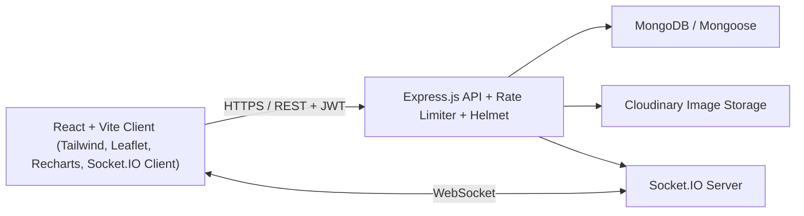
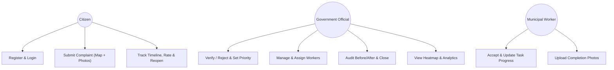
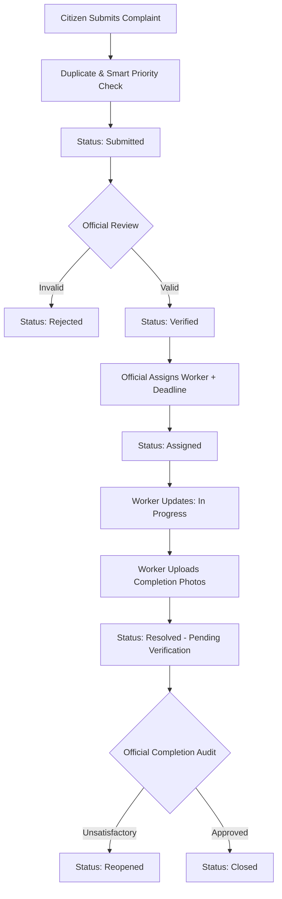
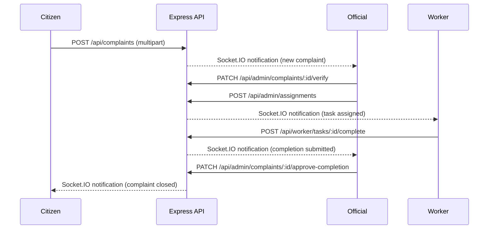
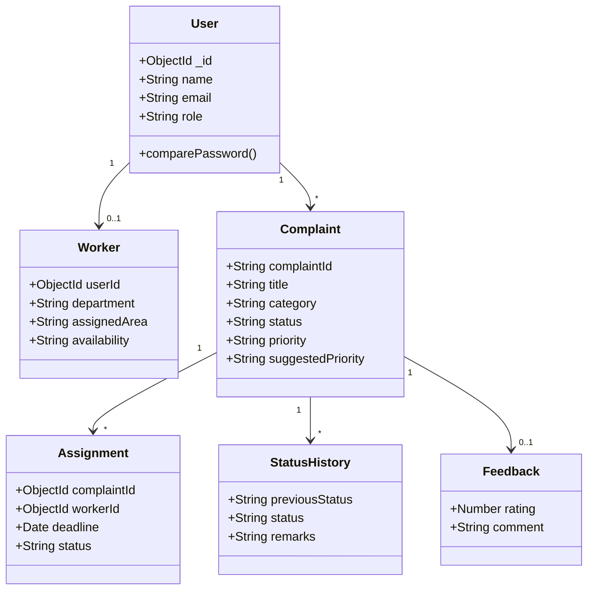
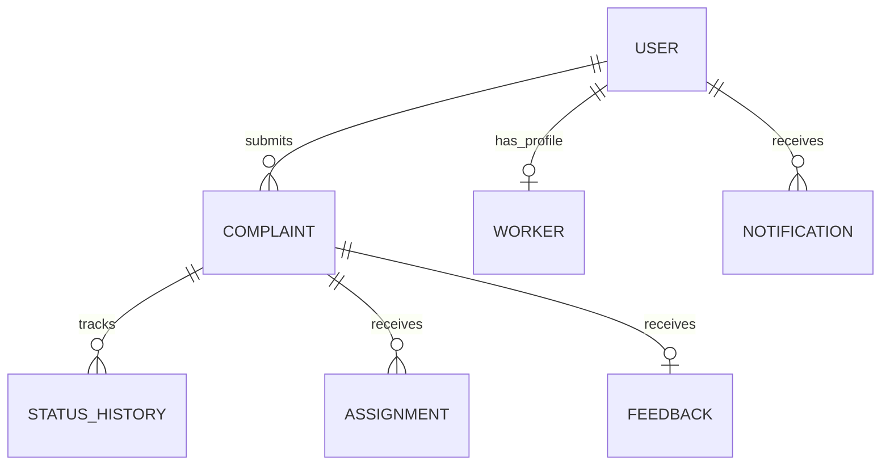

# Smart Civic Management System (SCMS) — Final Project Documentation

## 1. Project Introduction
The **Smart Civic Management System (SCMS)** is a full-stack MERN (MongoDB, Express.js, React.js, Node.js) web platform designed to modernize municipal issue reporting, field workforce dispatch, and public service accountability. It connects **Citizens**, **Government Officials (Admins)**, and **Municipal Workers** through a unified, role-secured workflow.

## 2. Problem Statement
Traditional municipal grievance systems rely on fragmented phone helplines, paper forms, and opaque status updates. Citizens lack visibility into whether issues are verified or assigned, officials lack geospatial hotspot insights and SLA tracking, and field teams lack structured before-and-after verification workflows.

## 3. Objectives and Scope
- Provide citizens with geo-tagged, photo-backed complaint submission and real-time tracking.
- Equip government officials with verification, worker management, deadline assignment, smart priority suggestions, duplicate detection, SLA escalation, heatmaps, and Recharts analytics.
- Provide municipal workers with dedicated task queues, progress updates, and completion photo uploads.
- Enforce strict role-based access control (RBAC) across all three roles.

## 4. Software Requirements Specification (SRS)
### Functional Requirements
- **Citizen:** Register/Login, Submit Complaint (map + multi-image), Duplicate Warning, Track Status Timeline, Rate Closed Complaints (1–5), Reopen Closed Complaints.
- **Government Official:** 8-metric Dashboard, Verify/Reject Complaints, Override Smart Priority, Register/Edit Workers, Assign Workers with Deadlines, Before-and-After Photo Verification, Escalation, Heatmap, Analytics & CSV Export.
- **Municipal Worker:** View Assigned Tasks, Accept Task, Update to `In Progress`, Upload Completion Photos (`Resolved - Pending Verification`).

### Non-Functional Requirements
- **Security:** `bcrypt` password hashing, JWT authentication, RBAC middleware, `helmet`, `express-rate-limit`, Multer MIME/size validation.
- **Performance:** Indexed MongoDB queries, sub-5ms duplicate scan across 500 records.

## 5. Feasibility Study
- **Technical Feasibility:** Built on mature open-source MERN technologies, Leaflet/OpenStreetMap, Recharts, Socket.IO, and Cloudinary.
- **Operational Feasibility:** Role-specific dashboards reduce training overhead for municipal staff and citizens.
- **Economic Feasibility:** Uses open-source mapping (OpenStreetMap) and free-tier-compatible cloud hosting (Vercel, Render, MongoDB Atlas, Cloudinary).

## 6. Agile SDLC Model and Sprint Planning
- **Sprint 1 (Phase 1):** Foundation, Auth/RBAC, Landing Page, Citizen Dashboard, Complaint Registration (Map + Images), Complaint Tracking.
- **Sprint 2 (Phase 2):** Official Dashboard, Complaint Verification, Worker Management, Worker Allocation, Worker Dashboard, Before-and-After Verification, Socket.IO Notifications.
- **Sprint 3 (Phase 3):** Smart Priority Engine, Duplicate Detection, Leaflet Heatmap, SLA Monitoring & Escalation, Worker Analytics, Citizen Feedback & Reopening, Recharts Analytics, Testing & Deployment Configs.

## 7. System Architecture

## 8. Use Case Diagram

## 9. Activity Diagram

## 10. Sequence Diagram

## 11. Class Diagram

## 12. ER Diagram

## 13. Database Design
Collections in MongoDB:
- `users`: Citizen, Official, and Worker authentication & profile records.
- `workers`: Municipal worker department, assigned area, availability, and active status.
- `complaints`: Core civic report, geo-coordinates, before/after images, smart priority metadata, duplicate flags, SLA/escalation flags.
- `assignments`: Worker allocation history, deadlines, instructions, and review timestamps.
- `statushistories`: Immutable audit log of `previousStatus` → `status`, updater, and remarks.
- `notifications`: Persisted real-time alerts for all roles.
- `feedbacks`: Unique 1–5 star ratings and comments per closed complaint.

## 14. Module Descriptions
1. **Authentication & RBAC:** JWT + bcrypt + `authorizeRoles`.
2. **Citizen Complaint & Tracking:** Leaflet map picker, multi-image upload, duplicate warning, timeline, feedback, reopen.
3. **Official Control Center:** Verification, priority override, worker management, assignment, before/after audit, escalation.
4. **Municipal Worker Portal:** Task queue, progress updates, completion evidence upload.
5. **Smart Features & Analytics:** Rule-based priority engine, Haversine + Jaccard duplicate detector, SLA monitor, Leaflet.heat heatmap, Recharts analytics.

## 15. Screenshots of the Application
*(Capture screenshots of the Landing Page, Citizen Dashboard, Complaint Form with Map, Admin Dashboard, Admin Heatmap, Admin Analytics, and Worker Task Detail after running `npm run dev` with MongoDB connected.)*

## 16. Testing Methodology
Automated tests were executed against the Express application (`server/src/tests/phase2.test.js` and `server/src/tests/phase3.test.js`) using Node `assert`, HTTP `fetch`, and in-memory Mongoose model stubs, alongside Vite production bundle verification (`npm run build`).

## 17. Test Cases and Results

| Test ID | Test Scenario | Preconditions | Test Input | Expected Result | Actual Result | Status |
| :--- | :--- | :--- | :--- | :--- | :--- | :--- |
| UT-01 | Smart priority emergency scoring | Rule engine loaded | Electricity + live wire + 3 nearby | `Emergency` (>=70) | Priority=Emergency, Score=100 | **PASS** |
| UT-02 | Smart priority low scoring | Rule engine loaded | Other + Low severity | `Low` (<25) | Priority=Low, Score=10 | **PASS** |
| UT-03 | Duplicate Haversine & text similarity | Detector loaded | Nearby coords + similar text | Distance <150m, Sim >0.2 | Distance=83m, Similarity=0.375 | **PASS** |
| UT-04 | SLA overdue calculation | Deadline in past | `-5h` deadline, `In Progress` | `Overdue` | State=Overdue, OverdueHours=5 | **PASS** |
| IT-01 | Duplicate check API | Citizen JWT | Similar complaint + coords | HTTP 200, >=1 match | Matches=1 | **PASS** |
| IT-02 | Citizen feedback submission | Closed complaint | Rating=5 + comment | HTTP 201 | HTTP 201 | **PASS** |
| IT-03 | Duplicate feedback prevention | Feedback exists | Second POST feedback | HTTP 409 | HTTP 409 | **PASS** |
| SY-01 | Citizen reopens closed complaint | Closed complaint | Reopen reason | Status=`Reopened` | Status=Reopened | **PASS** |
| SY-02 | Official escalates complaint | Official JWT | Escalation remarks | `Emergency`, `isEscalated=true` | Priority=Emergency, Escalated=true | **PASS** |
| ST-01 | Non-owner feedback blocked | Other citizen JWT | POST feedback | HTTP 403 | HTTP 403 | **PASS** |
| PT-01 | Duplicate scan 500 complaints | 500 records | `findPotentialDuplicates` | <200ms | 2.31ms | **PASS** |

## 18. Deployment Details
Deployment configurations are provided in `client/vercel.json`, `render.yaml`, and `docs/DEPLOYMENT_GUIDE.md` for Vercel (Frontend), Render (Backend + Socket.IO), MongoDB Atlas, Cloudinary, and GitHub.

## 19. Limitations
- Duplicate detection uses Haversine + Jaccard token similarity rather than semantic vector embeddings.
- Local development without MongoDB requires starting `mongod` or configuring a MongoDB Atlas `MONGO_URI`.

## 20. Future Enhancements
- Push notifications (Web Push / SMS) for field workers.
- Automated ML-based image classification for civic issue categories.
- Multi-language citizen interface (i18n).

## 21. Conclusion
SCMS delivers a complete, modular, role-secured MERN platform spanning citizen reporting, municipal verification, worker dispatch, before-and-after auditing, geospatial heatmaps, SLA tracking, and executive analytics.
